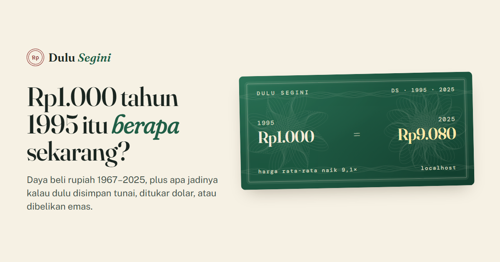

# Dulu Segini



**[Buka kalkulatornya](https://dulu-segini.vercel.app)**

Uang saku Rp500 tahun 1995 itu setara berapa sekarang? Dulu Segini menghitung daya beli
rupiah dari tahun ke tahun (1967–2025) dengan Indeks Harga Konsumen, lalu
menunjukkan apa jadinya kalau uang itu dulu:

- **disimpan tunai**: nominalnya tetap, daya belinya menyusut sebesar inflasi
- **ditukar dolar AS** dengan kurs tahun itu, lalu ditukar kembali sekarang
- **dibelikan emas** dengan harga rata-rata tahun itu

Semua dinyatakan dalam rupiah tahun terakhir, jadi yang dibandingkan adalah daya beli,
bukan angka.

## Fitur

- Dua arah: *dulu → sekarang* dan *sekarang → dulu*.
- Nominal bisa diketik bebas: `1.000`, `25.000`, `1,5 juta`, `500rb`, `2jt`.
- Kartu hasil bergaya uang kertas lama (pola guilloche digambar sendiri), bisa disimpan
  sebagai PNG. Setiap hasil punya tautan sendiri (`?rp=1000&th=1995`).
- Grafik nilai riil tiga skenario (skala logaritmik) dan grafik inflasi per tahun,
  masing-masing dengan tooltip dan tampilan tabel.
- Mode gelap mengikuti sistem.

## Data

| Seri | Sumber |
|---|---|
| Indeks Harga Konsumen (2010 = 100) | World Bank WDI `FP.CPI.TOTL` (data dasar BPS) |
| Kurs resmi Rp/US$, rata-rata tahunan | World Bank WDI `PA.NUS.FCRF` |
| PDB per kapita, rupiah berlaku | World Bank WDI `NY.GDP.PCAP.CN` |
| Harga emas, US$/troy ons, rata-rata tahunan | World Bank Commodity Price Data (Pink Sheet) |

Inflasi tahunan dihitung dari IHK yang sama, bukan diambil dari seri terpisah, supaya
semua angka konsisten. Mulai 1967 karena redenominasi 1965 dan hiperinflasi 1966.
Rumus, asumsi, dan batasannya ada di [halaman metode](https://dulu-segini.vercel.app/metode.html).

```
python data/skrip/ambil.py            # unduh ulang dari World Bank → src/data/seri.json
python data/skrip/ambil.py --luring   # bangun ulang dari data/mentah tanpa internet
```

Butuh `openpyxl` untuk membaca berkas Pink Sheet.

## Warna grafik

Tiga warna seri (tunai biru, emas oranye, dolar hijau toska) divalidasi untuk buta
warna terhadap latar terang dan gelap: ΔE CVD terburuk 9,2 (terang) dan 9,4 (gelap)
untuk semua pasangan. Dua warna di mode terang di bawah 3:1 terhadap latar, jadi
setiap garis diberi label langsung dan ada tampilan tabel.

## Menjalankan

```
npm install
npm run dev
npm test        # model dan pembaca nominal (vitest)
npm run build
```

Vite + TypeScript, tanpa framework UI; grafik dengan d3-scale dan d3-shape.
